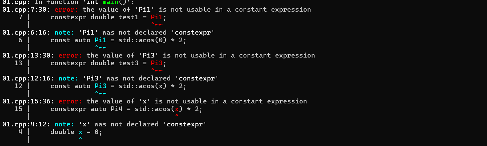
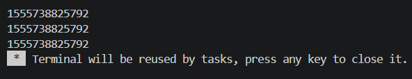

# Языки программирования
## Лабораторная работа 6

### Задание 1 **(3)**
*Рассмотрим следующую программу на С++.*
```
#include <iostream>
#include <cmath>
int main() {
   double x = 0;
   const auto Pi = std::acos(0) * 2;
   std::cout << Pi << std::endl;
   return 0;
}
```
*Проверьте четыре способа объявления* **Pi**.
* ```const auto Pi = acos(0) * 2;```
* ```constexpr auto Pi = std::acos(0) * 2;```
* ```const auto Pi = acos(x) * 2;```
* ```constexpr auto Pi = std::acos(x) * 2;```

*Что можно сказать об этих вариантах? Проверьте, в каких вариантах объявляется константа этапа трасляции.*
* Константа этапа трансляции — constexpr auto Pi = std::acos(0) * 2;
* Константные объекты — const auto Pi = std::acos(0) * 2; и const auto Pi = std::acos(x) * 2;
* Ошибка компиляции — constexpr auto Pi = std::acos(x) * 2; (значение переменной x неизвестно на этапе трансляции).

* Проверка
```
#include <cmath>

int main() {
    double x = 0;

    const auto Pi1 = std::acos(0) * 2;
    constexpr double test1 = Pi1;

    constexpr auto Pi2 = std::acos(0) * 2;
    constexpr double test2 = Pi2;

    const auto Pi3 = std::acos(x) * 2;
    constexpr double test3 = Pi3;

    constexpr auto Pi4 = std::acos(x) * 2;
    constexpr double test4 = Pi4;

    return 0;
}
```


*Тексты программ разместите в папке с номером задания*


### Задание 2 **(2)**
*Проверьте работу следующей программы на С++*
```
#include <iostream>
int main() {
   {
      int x, y;
      std::cin >> x >> y;
      std::cout << x+y << std::endl;
   }
   {
      double x, y;
      std::cin >> x >> y;
      std::cout << x+y << std::endl;
   }
   return 0;
}
```
*Нужны ли в этой программе вложенные фигурные скобки? Дайте подробный ответ с объяснением причин.*
* Для того, чтобы она запустилась - да, нужны. Возникнет ошибка компиляции
* |error: conflicting declaration 'double x'|
 error: conflicting declaration 'double y'|
* Нельзя объявить одну и ту же переменную дважды, скобки создают отдельные области видимости 


### Задание 3 **(2)**
*Проверьте работу следующего фрагмента программы на С++.*
```
int s = 0;
for (int i = 0; i < 4; i++) {
   for (int i = 0; i < 3; i++) {
      s += i;
      std::cout << i << '\n';
   } 
   s += i; 
   std::cout << i << '\n';
}
std::cout << s;
```
*В результате каких вычислений был получен ответ? Дайте подробный ответ.*
* 18
* Цикл 1 - внешний, цикл 2 - внутренний 
* Цикл 1 i = 0: цикл 2 прибавляет 0 + 1 + 2 = 3 (s становится 3), затем действие в цикле 1  i (3 + 0 = 3).
* Цикл 2 i = 1: прибавляет 0 + 1 + 2 = 3 (s становится 6), затем действие в цикле 1  i (6 + 1 = 7).
* Цикл 1 i = 2: цикл 2 прибавляет 0 + 1 + 2 = 3 (s становится 10), затем действие в цикле 1  i (10 + 2 = 12).
* Цикл 1 i = 3: цикл 2 прибавляет 0 + 1 + 2 = 3 (s становится 15), затем действие в цикле 1  i (15 + 3 = 18).

### Задание 4 **(2)**

*Проверьте работу следующего фрагмента программы на* **Python**.
```
s = 0
for i in range(4):
   for i in range(3):
      s += i
   s += i
print(s)
```
*В результате каких вычислений был получен ответ? Дайте подробный ответ.*
*На основе этих примеров поясните различия между* **С++** и **Python** *при работе с переменными*.

* Результат - 20 
* Цикл 1 - внешний, цикл 2 - внутренний. 
* Цикл 1 i = 0: цикл 2 прибавляет 0 + 1 + 2 = 3 (s становится 3), затем  в цикле 1 с i = 2 (3 + 2 = 5).
* Цикл 1 i = 1: цикл 2 прибавляет 0 + 1 + 2 = 3 (s становится 8), затем  в цикле 1 с i = 2 (8 + 2 = 10).
* Цикл 1 i = 2: цикл 2 прибавляет 0 + 1 + 2 = 3 (s становится 13), затем  в цикле 1 с i = 2 (13 + 2 = 15).
* Цикл 1 i = 3: цикл 2 прибавляет 0 + 1 + 2 = 3 (s становится 18), затем  в цикле 1 с i = 2 (18 + 2 = 20).
* В питоне ссылка на переменную на i меняется, а не создается новая, поэтому после цикла 2 значение i равно 2 

### Задание 5 **(2)**

*Напишите свой пример программы на* **С++**, *создающий и использующий пространства имен. Программа
должна содержать не менее двух пространств имен.*
```
#include <iostream>
#include <fstream>

namespace output {
    void print(const std::string& msg) {
        std::cout << msg << '\n';
    }
}

namespace file {
    void print(const std::string& msg) {
        std::ofstream f("output.txt");
        f << msg;
    }
}

int main() {
    output::print("aaa");
    file::print("aaa");

}
```

### Задание 6 **(2)**

*Рассмотрим следующий фрагмент программы. Эта программа 1000000 раз обменивает значения двух длинных 
строк с использованием третьей строки. Проверьте, насколько быстро она работает.*

```
std::string a(100000, 'a');
std::string b(100000, 'b');
for (int i=0;i<1000000;i++) {
   std::string c(a);
   a = b;
   b = c;
}
std::cout << a[0] << b[0];
```
*Попробуйте использовать для обмена значений строк функцию* **swap**. 
*Проверьте, изменилось ли время работы. В чем ошибка исходной программы?
Исправьте исходную программу, чтобы ускорить ее работу. Изменения не должны 
затрагивать общий вид программы (присваивания, использование временной переменной).*
* Программа в исходном виде глоток несколько секунд: успел сделать глоток чая
* После добавления swap уже не успел сделать глоток чая 
* Ошибка в создании временной строки c двумя оператора присваивания, создается полная копия данных 
* исправление 
```
#include <iostream>
#include <string>
#include <utility> 

int main() {
    std::string a(100000, 'a');
    std::string b(100000, 'b');
    
    for (int i = 0; i < 1000000; i++) {
        std::string c(std::move(a));  
        a = std::move(b);             
        b = std::move(c);            
    }
    
    std::cout << a[0] << b[0] << std::endl;
    return 0;
} 
```


### Задание 7 **(2)**

*Рассмотрим программу на языке* **Python**.

```
a = 'Hello world'
print(a, id(a))
b = a
print(b, id(b))
a += ' and goodbye'
print(a, id(a))
print(b, id(b))
```   

*Объясните ее работу. В какой момент создавались строки? 
Что означает значение, возвращенное функцией* **id**?
* Программа выводит адреса строк в памяти(id)
* создается в момент вызова операнда

### Задание 8 **(2)**

*Пусть* **a** - *строковая переменная в программе на* **Python**.
*Есть ли разница между работой присваивания*
```b = a```
и
```b = a[:]```
*Напишите программу для демонстрации различий.*
* Демонстрация различий показала, что различий нет
```
a = 'aaa'

b = a 
print(id(a))
print(id(b))

b = a[:]
print(id(b))
```

###  Задание 9 **(3)**
*Напишите программу на языке* **Python**, *которая создаст 2600 переменных с именами
от* **a0** *до* **a99**, *от* **b0** *до* **b99** *и так далее, от* **z0** *до* **z99**. 
*Присвойте всем переменным различные значения от 1 до 2600.*
```
for i in range(26):
    letter = chr(ord('a') + i)     
    for j in range(100):
        vars()[letter + str(j)] = i * 100 + j + 1

print(a0)    
print(z99)   
```


## Дополнительные задания

### Задание 1 **(3)**

*Пусть* **a**, **b**  *два списка в* **Python**. *Мы хотим обменять значения переменных следующим
образом.*
``` 
a, b = b, a
```
*Будет ли это работать? В какой последовательности будут происходить присваивания?
Будет ли зависеть время работы от размера списков? Обоснуйте ответ.*
Да, будет
### Задание 2 **(3)**
*Проверьте результаты сравнения в* **Python**.
```
id(100)==id(100)
```
и
```
id(1000)==id(1000)
```
*Как можно объяснить полученные результаты?*

### Задание 3 **(4)**
*Напишите функцию* **sumint** на **Python**, *которая найдет сумму всех целочисленных переменных, определенных
в среде* **Idle**. *Например*
```
>>> a = 10
>>> b = 1.5
>>> c = 15
>>> d = 'hello'
>>> sumint()
25
```

### Задание 4 **(10)**

*В языке* **С++** *для получения информации о расположении переменной в памяти 
можно использовать оператор взятия адреса* **&**. *Адрес можно интерпретировать, как 
беззнаковое длинное число с использованием* **reinterpret_cast**.

```
reiterpret_cast<unsigned long long>(&t);
```
*Здесь* **t** *имя некоторой переменной. Напишите несколько примеров, чтобы проверить, 
как размещаются переменные в памяти. В частности, можно рассмотреть следующие вопросы.*
* *Если объявить несколько переменных различных типов в одном блоке, то на какую величину 
отличаются их адреса? Соотносится ли эта величина с размером переменной в байтах.
Проверьте, имеются ли различия на разных уровнях оптимизации.*
* *Если имеется несколько блоков, расположенных последовательно, то могут ли переменные
в разных блоках иметь одинаковые адреса? Проверьте разные уровни оптимизации.*
* *Объявите несколько переменных типа* **std::string** *и попробуйте заносить
в них строки различной длины. Изменяется ли размер переменной, вычисленный с использованием*
**sizeof**? *Изменяется ли расположение переменной? Попробуйте объяснить полученные результаты.*


